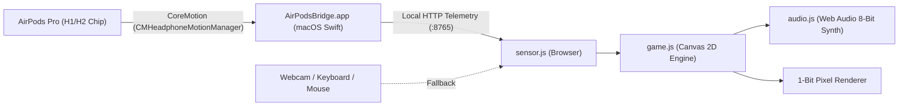

# 💀 DEATH SENSOR - 1-Bit AirPods Pro Zombie Shooter

> **A retro 1-bit monochrome 2D first-person zombie shooter controlled via real-time head motion tracking using AirPods Pro.**


---

## 🎮 Highlights & Features

- **🎧 Real Hardware Head Tracking (AirPods Pro)**:
  - ดึงค่า **Roll** (การเอียงคอซ้าย-ขวา) และ **Yaw** (การหันหน้าซ้าย-ขวา) จากชิป Gyroscope / Accelerometer ของ AirPods Pro ที่สวมอยู่จริงแบบ Real-time
  - กดปุ่ม **`[C]`** หรือปุ่ม **RE-CENTER** บนหน้าจอเพื่อตั้งตำแหน่งศูนย์กลางหน้าตรงได้ทันที
  - มีระบบ Fallback ในตัว: รองรับ Webcam Head Tracking (Face detection), iOS DeviceOrientation, หรือใช้เมาส์ / ปุ่ม `[A]`, `[D]` / ลูกศรซ้าย-ขวา
- **🕹️ 1-Bit Monochrome Retro Aesthetic**:
  - กราฟิกสไตล์ขาว-ดำล้วน 100% พร้อม Dithering และ CRT Scanline
  - มุมมองบุคคลที่หนึ่ง (First-Person 2.5D Sprite Scaling)
  - ปรับสเกลขนาดปืนกะทัดรัด มองเห็นสนามรบและคลื่นซอมบี้ได้อย่างชัดเจน
- **🔫 Auto-Fire & 10 Unique Weapon Perks**:
  - ปืนจะยิงรัวอัตโนมัติ (Continuous Auto-Fire) ตลอดเวลา
  - ทุกๆ **10 เวฟ (Wave 10, 20, 30...)** เกมจะหยุดชั่วคราวและสุ่ม **3 จาก 10 ลูกเล่น** มาให้อัปเกรด:
    1. **Twin Barrel**: ยิงกระสุนคู่ 2 นัดขนานกัน
    2. **Heavy Caliber**: เพิ่มดาเมจกระสุน +45%
    3. **Rapid Trigger**: เพิ่มอัตราการยิงถี่ขึ้น +40%
    4. **Piercing Shot**: กระสุนเจาะทะลุศัตรูตัวหน้าไปโดนตัวหลัง
    5. **Buckshot Spread**: ยิงกระจาย 3 เม็ดในวิถีพัด
    6. **High Velocity**: กระสุนพุ่งเร็วขึ้น 2 เท่า ลดดีเลย์เข้าเป้าไกล
    7. **Hollow Point Crit**: เพิ่มโอกาสติดคริติคอล 30% ทำดาเมจ x2.5 เท่า
    8. **Knockback Shock**: ยิงผลักซอมบี้ให้กระเด็นถอยหลัง
    9. **Cryo Stun Round**: กระสุนสโลว์ความเร็วซอมบี้ 45% นาน 2 วินาที
    10. **Adrenaline Repair**: ฟื้นฟู 30 HP ทันที และยิงเร็วขึ้นมากเมื่อเลือดต่ำกว่า 40
- **🧟 Balancing & Damage Rules**:
  - เลือดผู้เล่นคงที่แน่นอนที่ **100 HP**
  - เมื่อซอมบี้เดินประชิดตัวจอ: ทำดาเมจ **10 หน่วยทันที** และหากยังไม่ตาย จะทำซ้ำอีก **10 หน่วยทุกๆ 3 วินาที**
  - ศัตรูหลากหลายประเภทตามเวฟ: *Walker* ทั่วไป, *Runner* วิ่งไว (เวฟ 5+), และ *Brute Tank* เลือดเยอะ (เวฟ 12+)
- **🔊 Pure Web Audio 8-Bit Synthesizer**:
  - สร้างเสียงสังเคราะห์แบบเรียลไทม์ (เสียงกระสุน, เสียงเจาะเนื้อ, ซอมบี้คำราม, เสียงโดนกัด, เสียงแฟนฟาร์ตอนจบเวฟ) โดยไม่ต้องพึ่งไฟล์เสียงภายนอก
- **🖥️ Standard UI/UX**:
  - หน้า Title Menu, HUD แสดงแถบเลือด, Wave, หลอดวัดองศาหัว, Pause Menu (`ESC`), และ Game Over Stats

---

## 🏗️ Architecture



---

## 🚀 Quick Start (วิธีรันและเล่นเกม)

### ความต้องการของระบบ:
- macOS (รองรับ Apple Silicon & Intel)
- AirPods Pro, AirPods Max หรือ AirPods รุ่นที่รองรับ Head Tracking
- เว็บเบราว์เซอร์ (Chrome, Safari, Edge, หรือ Firefox)

### 1. Clone repository
```bash
git clone https://github.com/<your-username>/airpods-games.git
cd airpods-games
```

### 2. เริ่มต้น Native AirPods Bridge (บน macOS)
รันสคริปต์เพื่อเปิดแอปตัวกลางอ่านค่าเซนเซอร์ AirPods:
```bash
open -a "./AirPodsBridge.app"
```
*(หรือคอมไพล์ใหม่เองได้ง่ายๆ ด้วยคำสั่ง: `xcrun swiftc bridge.swift -o AirPodsBridge.app/Contents/MacOS/AirPodsBridge && codesign --force --deep --sign - AirPodsBridge.app && open -a "./AirPodsBridge.app"`)*

> [!NOTE]
> หากเปิดครั้งแรก macOS จะขอสิทธิ์ **"AirPodsBridge Would Like to Access Your Motion & Fitness Activity"** ให้กด **Allow (อนุญาต)**

### 3. เปิด Web Server
เปิดเซิร์ฟเวอร์รันหน้าเว็บในไดเรกทอรีโปรเจกต์:
```bash
python3 -m http.server 8080
```

### 4. เข้าเล่นเกม
1. เปิดเบราว์เซอร์ไปที่ **[http://localhost:8080](http://localhost:8080)**
2. ใส่ AirPods Pro ในหู (อย่างน้อย 1 ข้าง)
3. สังเกตที่หน้าจอจะขึ้นสถานะ:
   `🎧 AIRPODS PRO CONNECTED! (Roll: ...° | Yaw: ...°)`
4. มองตรงไปที่กลางจอ แล้วกดปุ่ม **`[C]`** (หรือปุ่ม **RE-CENTER**) เพื่อตั้งจุดศูนย์กลางหัว
5. กด **START GAME** แล้วโยกหัวหรือหันหน้าซ้าย-ขวาเพื่อเล็งยิงได้ทันที!

---

## ⌨️ Controls & Shortcuts

| Action | Control |
|---|---|
| **เล็งปืน (Aim / Pan)** | **โยกศีรษะ หรือหันหน้า ซ้าย-ขวา (AirPods Pro)** |
| **ตั้งศูนย์กลางหน้าตรง (Re-center)** | กดปุ่ม **`[C]`** หรือปุ่ม **RE-CENTER** บนหน้าจอ |
| **ยิงปืน (Shoot)** | **อัตโนมัติ (Auto-Fire)** |
| **Fallback Controls** | เลื่อนเมาส์ หรือปุ่ม **`[A]`** / **`[D]`** หรือลูกศร **`[Left]`** / **`[Right]`** |
| **หยุดเกมชั่วคราว (Pause)** | กดปุ่ม **`[ESC]`** หรือปุ่ม **PAUSE** บน HUD |

---

## 📁 Project Structure

```
Airpods Games/
├── AirPodsBridge.app/   # Native macOS bridge app bundle with CoreMotion entitlements
├── bridge.swift         # Swift CoreMotion daemon streaming AirPods telemetry via HTTP :8765
├── index.html           # Main HTML structure, CRT overlays, HUD & menus
├── style.css            # 1-Bit Monochrome pure black & white stylesheet
├── sensor.js            # AirPods Bridge client, head-tracking smoothing & fallbacks
├── sprites.js           # 1-Bit procedurally generated pixel art bitmaps & dithering
├── audio.js             # Web Audio API 8-bit sound synthesizer
├── game.js              # Game engine loop, zombies, waves, balance & 10 perks
└── headtrackr.min.js    # Built-in fallback webcam face tracker
```

---

## 📄 License
This project is open-source and available under the [MIT License](LICENSE).
